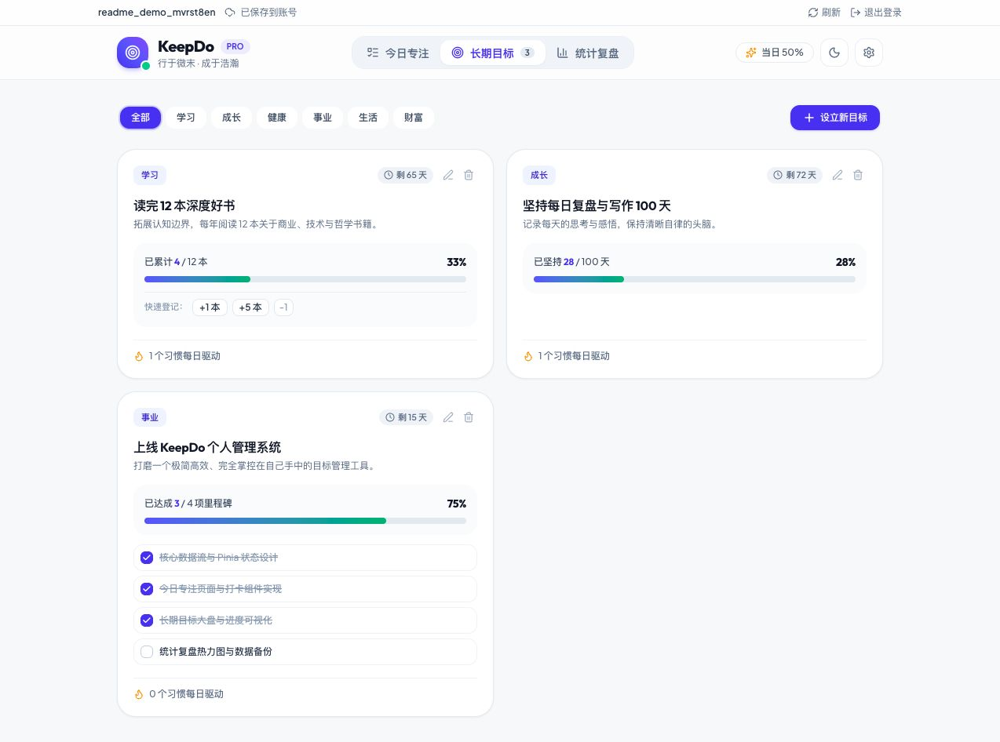
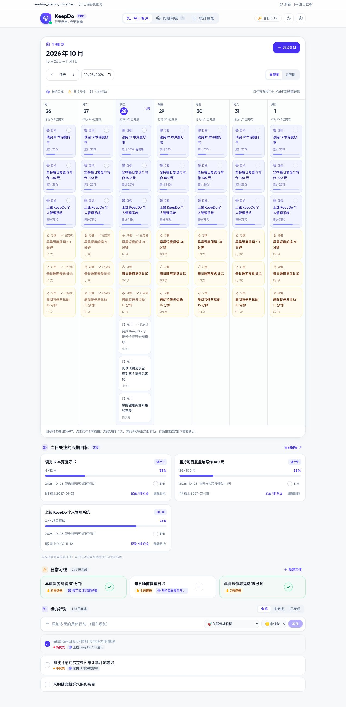
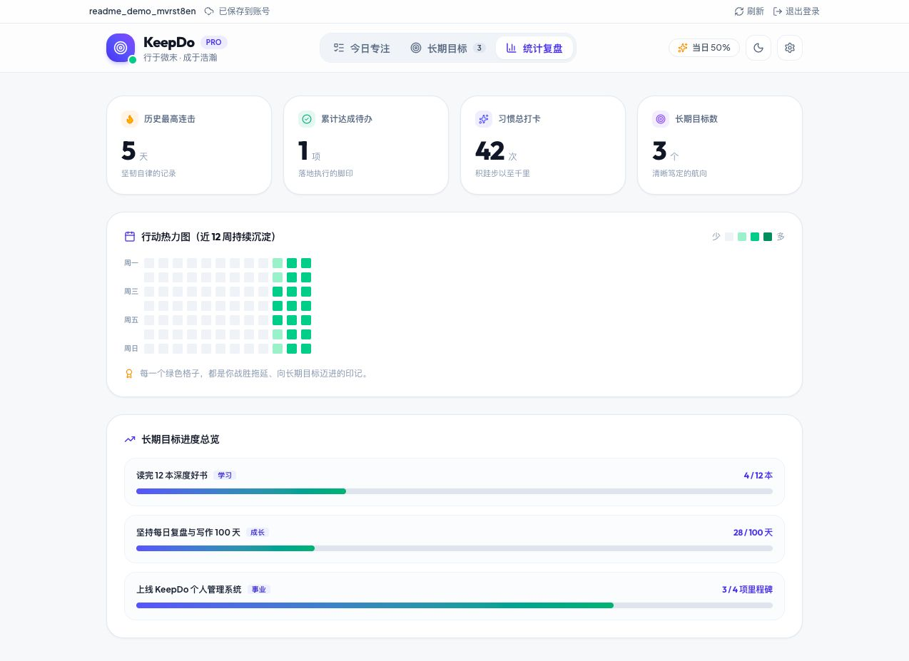

# KeepDo

**每日行动 · 沉淀长期目标**

KeepDo 是一款把长期目标、日常习惯和待办行动放在一起的个人管理工具。从「读完 12 本书」到「每天阅读 30 分钟」，用计划日历安排今天，用打卡记录坚持，用成长时间线留下过程。

[在线体验](https://keepdo.shindouhiro.workers.dev) · [产品截图](#产品截图) · [本地运行](#启动与运行) · [部署说明](#部署到-cloudflare)



## 核心功能

| 功能 | 你可以做什么 |
| --- | --- |
| 长期目标 | 用天数、数值或里程碑衡量进度，按分类管理目标，查看截止日与剩余天数 |
| 计划日历 | 切换周视图与月视图，把目标、习惯和待办放进同一个日历，点击日期查看详情 |
| 习惯与待办 | 为习惯编写描述，一键打卡、查看连续天数，为待办设置优先级并关联长期目标 |
| 目标与习惯日记 | 为目标或习惯留下文字和图片，按日期回看成长时间线 |
| 统计复盘 | 查看近 12 周行动热力图、习惯打卡次数、最长连击与目标进度 |
| 账号与数据 | 注册登录、跨设备读取账号数据，通过 JSON 导入导出基础业务数据 |
| 深浅主题 | 跟随系统初始化主题，也可手动切换；界面适配桌面与移动端 |

## 产品截图

以下截图来自本地运行的 KeepDo，使用独立演示账号与示例数据。截图中的进度、记录和统计仅用于展示产品。

### 今日专注：把目标落到每一天

计划日历按日期展示长期目标、日常习惯与待办，支持周、月视图切换和指定日期跳转。日历下方集中展示当日关注的目标、习惯打卡和待办清单，方便安排与执行当天的行动。

- 点击日期，查看目标说明、里程碑、习惯记录和待办全文，也能直接完成、编辑或添加事项。
- 待办支持高、中、低优先级，以及全部、未完成、已完成筛选。
- 目标支持当天打卡与历史补卡，点击已打卡可撤销，未来日期暂不能打卡。



### 长期目标：选择适合自己的进度方式

上方工作台截图展示了三种目标模型。每张目标卡片都有分类、截止提醒和进度条，还能关联日常习惯。

| 目标模型 | 示例 | 如何推进 |
| --- | --- | --- |
| 数值量化 | 读完 12 本深度好书 | 自定义单位，通过快捷按钮登记累计数量 |
| 天数打卡 | 坚持每日复盘与写作 100 天 | 目标打卡或完成关联习惯，同一天合计累计 1 天 |
| 阶段里程碑 | 上线 KeepDo 个人管理系统 | 将目标拆成阶段，勾选里程碑更新进度 |

数值型与里程碑型目标的日历打卡用于标记当天已行动；累计数量和阶段完成状态分别在目标卡片中更新。当日行动完成率单独统计习惯与待办。

### 目标与习惯日记：记录进展，也留下思考

点击日历中的目标标题，或目标卡片上的「记录 / 时间线」，即可打开目标日记。为所选日期写下行动、收获与感受，在成长时间线中回看并编辑已有记录。

习惯同样支持图文日记：在「管理日常习惯」中填写固定描述，点击习惯标题、卡片上的「记录 / 时间线」，或日历中的习惯，即可为所选日期添加文字和图片。日期详情也提供记录入口，有记录的日期会显示标记。日记独立保存，写记录不会自动完成习惯打卡。

每条记录支持最多 5,000 字和 6 张图片，图片支持 JPG、PNG、WebP，上传前自动压缩；文字和图片也可以单独保存。


### 统计复盘：看见持续行动的积累

通过近 12 周的行动热力图观察自己的节奏，结合历史最高连击、累计达成待办、习惯总打卡与长期目标进度，回顾哪些计划正在稳定推进。



## 开始使用

1. 注册账号并登录，创建自己的个人空间。
2. 在「长期目标」中设立目标，选择天数、数值或里程碑模型。
3. 回到「今日专注」，创建关联习惯与待办，通过日历安排每日行动。
4. 完成后打卡，写下目标或习惯日记，再到「统计复盘」回看积累。

想先了解操作，可以在「设置与数据管理」中载入精选示例数据。**载入示例和导入 JSON 都会替换当前账号的目标、习惯（含固定描述）、待办与分类，请先导出备份。当前 JSON 备份不包含目标、习惯的图文日记及其图片。**

## 🛠️ 技术选型

- **Vue 3**：Composition API (`<script setup>` + TypeScript)
- **Vite 8**：极速构建与开发体验
- **Tailwind CSS v4**：现代轻量原子样式系统，深浅主题自适应
- **Pinia**：响应式状态管理与账号数据同步
- **Cloudflare Workers + D1**：账号认证、同源 API 与持久化数据库
- **Lucide Icons**：简洁精致的线性矢量图标库
- **Canvas Confetti**：激励仪式感微动效

---

## 启动与运行

本地开发需要 Node.js 和 pnpm。项目采用 pnpm workspace，并通过 Catalogs 管理部分依赖版本。

```bash
# 安装依赖
pnpm install

# 一条命令启动前后端（自动迁移本地数据库、构建资源，等待 API 就绪后启动前端）
pnpm dev

# 按 Ctrl+C 同时停止前后端

# 按需单独启动前端或后端
pnpm dev:web
pnpm dev:api

# 构建生产版本 (含 vue-tsc 类型检查)
pnpm build

# 本地预览完整生产应用（含 API）
pnpm dev:api
```

启动后访问 Vite 输出的本地地址，默认是 [http://localhost:5173](http://localhost:5173)。本地数据库与线上 D1 分离，首次使用需要在本地注册账号。

前端 `/api` 请求代理到 `localhost:8787`。单独运行 `pnpm dev:web` 时，需要另开终端运行 `pnpm dev:api`；首次单独启动后端前，先执行 `pnpm db:migrate:local` 和 `pnpm build:cloudflare`。

## 项目结构

```text
KeepDo/
├── src/
│   ├── components/       # 今日专注、目标、统计、账号与图文日记界面
│   ├── composables/      # 目标、习惯共用的日记与弹窗逻辑
│   ├── stores/           # Pinia 业务数据、账号与日记状态
│   └── lib/              # API 请求与日记图片处理
├── server/
│   ├── migrations/       # D1 数据库迁移
│   ├── auth.ts           # 账号认证与会话
│   └── journal.ts        # 目标、习惯日记与图片接口
├── shared/               # 前后端共用的数据校验、日历与打卡逻辑
├── tests/                # 单元测试与 API 集成测试
├── docs/screenshots/     # README 产品实拍截图
└── wrangler.jsonc        # Cloudflare Workers 与 D1 配置
```

## 部署到 Cloudflare

本项目通过 Cloudflare Workers 托管前端静态资源与同源 `/api/*` 接口，通过 D1 持久保存账号、会话及业务数据，部署设置保存在 `wrangler.jsonc`。`pnpm build:cloudflare` 使用根路径资源地址，普通 `pnpm build` 保留 GitHub Pages 所需的相对路径。

线上地址：[KeepDo](https://keepdo.shindouhiro.workers.dev)。

```bash
# 首次部署：在浏览器完成 Cloudflare 授权
pnpm cf:login

# 检查当前账户
pnpm cf:whoami

# 构建并检查部署配置，不上传
pnpm deploy:check

# 首次部署或新增数据库迁移时，先应用迁移
pnpm db:migrate:remote

# 构建并发布，成功后终端会返回实际访问地址
pnpm run deploy
```

当前发布更新同名 `keepdo` Worker，数据库绑定 `DB` 指向 `keepdo-db`。换账户部署时先创建目标 D1，再将实际 database_id 写入配置，不能沿用其他账户的数据库 ID。多账户时，部署前通过 `CLOUDFLARE_ACCOUNT_ID` 指定目标账户。令牌不应写入仓库。

旧版本地数据不会自动上传。登录后可点击「导入旧数据」迁移当前浏览器的数据，或在设置中导入原站导出的 JSON；导入会替换当前账号数据，原始旧本地数据保留。当前版本支持用户名密码注册、登录及退出，暂不提供密码找回。

## 账号与同步

- 用户名为 3–32 位字母、数字或下划线，不区分大小写；密码为 10–128 位。密码使用独立随机盐与原生 scrypt 保存摘要，登录会话保存在 HttpOnly Cookie 中。
- 数据库按服务端会话中的用户 ID 查询，客户端不能指定其他账号。数据库写入使用版本检查，另一台设备已修改时返回冲突，避免静默覆盖。
- 页面顶部显示保存状态。保存失败时保留当前页面并重试；发生冲突时先在设置中导出备份，再刷新云端内容。未保存时关闭页面会提示。
- 切回页面时，在没有本地未保存修改的情况下刷新云端数据；不是多人实时协作服务。
- 本版本需要 Workers API，GitHub Pages 工作流仅能托管前端文件，不能单独提供完整账号功能。

## 验证

```bash
# 密码、会话令牌、校验与同源保护测试
pnpm test

# 在 pnpm dev:api 已启动且本地迁移完成后运行真实 API 测试
pnpm test:api

# 前后端类型检查、生产构建及 Wrangler 配置检查
pnpm deploy:check
```

API 集成测试只默认访问本地环境，会创建专用测试账号；远程验证必须显式指定测试目标。禁止将生产用户密码、会话或 API Token 提交到仓库。
