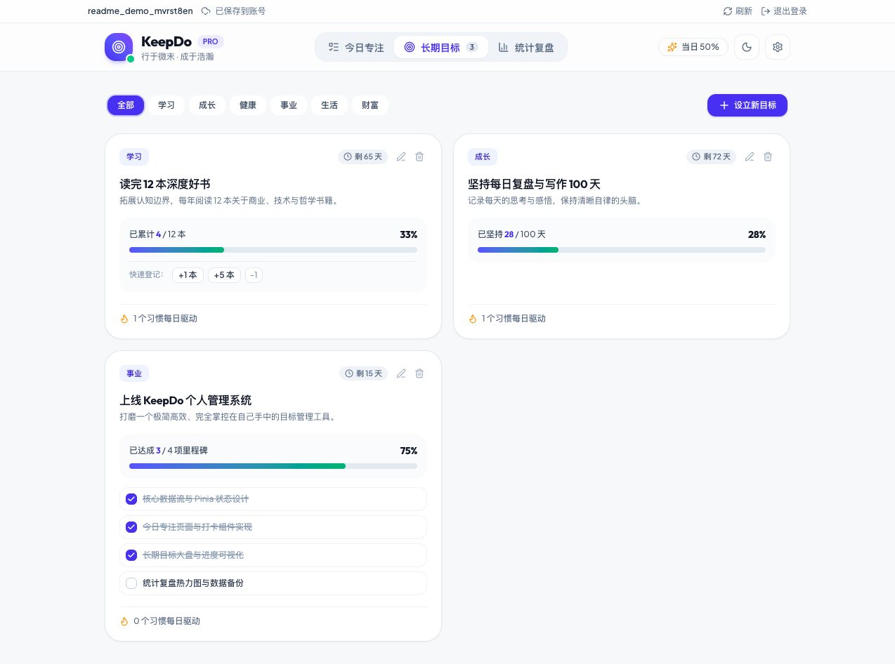
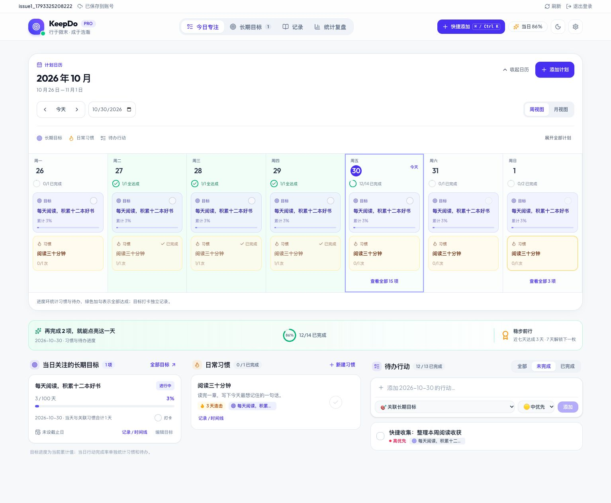
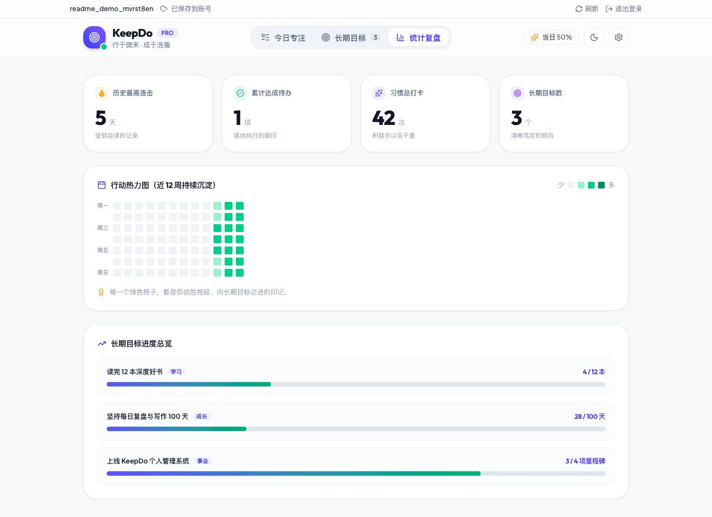

# KeepDo

**每日行动 · 沉淀长期目标**

KeepDo 是一款把长期目标、日常习惯和待办行动放在一起的个人管理工具。从「读完 12 本书」到「每天阅读 30 分钟」，用计划日历安排今天，用打卡记录坚持，用成长时间线留下过程。

[在线体验](https://keepdo.shindouhiro.workers.dev) · [产品截图](#产品截图) · [本地运行](#启动与运行) · [部署说明](#部署到-cloudflare)



## 核心功能

| 功能 | 你可以做什么 |
| --- | --- |
| 长期目标 | 用天数、数值或里程碑衡量进度，按分类管理目标，查看截止日与剩余天数 |
| 计划日历 | 切换周/月视图，滚动查看每天全部计划，切换卡片详情，收起日历，查看日期进度环与全部事项 |
| 快捷收集 | 任意主页面点击「快捷添加」或按 `⌘ / Ctrl + K`，设置日期、优先级并关联长期目标 |
| 行动成就 | 完成当日习惯与待办点亮日期，积累近七天完整达成日，获得行动徽章 |
| 习惯与待办 | 为习惯编写描述，一键打卡、查看连续天数，为待办设置优先级并关联长期目标 |
| 目标与习惯日记 | 为目标或习惯留下文字和图片，按日期回看成长时间线 |
| 记录时间线 | 在主导航「记录」中集中回看所有图文记录，按目标或习惯筛选，并分页浏览历史 |
| 统计复盘 | 查看近 12 周行动热力图、习惯打卡次数、最长连击与目标进度 |
| 账号与数据 | 注册登录、跨设备读取账号数据，通过 JSON 完整备份与恢复基础数据、图文日记及图片 |
| GitHub 异地备份 | 连接私有仓库，手动保存完整快照，分页查看历史并确认恢复 |
| 深浅主题 | 跟随系统初始化主题，也可手动切换；界面适配桌面与移动端 |

## 产品截图

以下截图来自本地运行的 KeepDo，使用独立演示账号与示例数据。截图中的进度、记录和统计仅用于展示产品。

### 今日专注：把目标落到每一天

计划日历按日期展示长期目标、日常习惯与待办，支持周、月视图切换和指定日期跳转。日历下方集中展示当日关注的目标、习惯打卡和待办清单，方便安排与执行当天的行动。

日历的周、月视图都包含每天全部计划，事项较多时在当天列表内上下滚动，目标与习惯卡片显示「写记录」或「记录 / 时间线」，单击即可为对应日期写记录，双击也会保持记录弹窗打开。「紧凑卡片」最多预览两行标题，「完整卡片」展示完整标题；两种模式都保留全部事项。「日程详情」可集中查看和编辑当天安排。日历可收起为所选日期摘要，手机端支持横向滑动，切换日期时让所选日期保持在可见区域。日期进度环、完成数字及绿色勾选共同表达状态，不依赖颜色判断。

桌面宽屏（1280px 起）将目标、习惯和待办分为三栏，工作区最多 1440px；手机和平板保持纵向阅读。顶部「快捷添加」在今日、目标、记录和统计页均可用，默认安排在今天，也可改为其他日期；快捷键为 `⌘ / Ctrl + K`，编辑输入或已有弹窗打开时不会触发。保存失败会保留草稿供重试，重试不会重复添加。

所有应用弹出界面统一为抽屉式：目标、习惯、待办编辑、日程详情、设置、日记、图片大图、记录长图预览及各类确认均从右侧全高展开，窄屏铺满屏幕。表单和设置在内部滚动，关闭与底部保存操作保持可见；支持 Escape、键盘焦点约束和关闭后返回触发入口。备份恢复、示例数据重置、账号数据覆盖和 GitHub 断开也使用确认抽屉，取消后保留原数据。

「行动成就」显示所选日期的习惯与待办进度，以及截至今天的近七天完整达成天数：1 天解锁「行动启程」、3 天「稳步前行」、7 天「七日之星」。这些是滚动七天内的累计天数，无需连续；空计划与未来日期不计入徽章。徽章直接由当前记录计算，撤销完成、增删计划后会同步更新。每日全部完成会触发现有庆祝动画，系统开启「减少动态效果」时不播放。当前提供应用内快捷收集与轻量徽章，浏览器扩展、系统级快捷键、可拖拽面板及代币/盲盒仍为后续方向。

- 点击日期，查看目标说明、里程碑、习惯记录和待办全文，也能直接完成、编辑或添加事项。
- 待办支持高、中、低优先级，以及全部、未完成、已完成筛选。
- 目标支持当天打卡与历史补卡，点击已打卡可撤销，未来日期暂不能打卡。
- 日历中，当天已打卡的目标、已完成的习惯与待办卡片统一显示为绿色，并保留勾选和状态文字；撤销后恢复类型配色。目标累计达成不代表历史每一天都已打卡。



[查看手机端收起日历后的布局](docs/screenshots/issue-1-mobile.jpg)

### 长期目标：选择适合自己的进度方式

上方工作台截图展示了三种目标模型。每张目标卡片都有分类、截止提醒和进度条，还能关联日常习惯。

| 目标模型 | 示例 | 如何推进 |
| --- | --- | --- |
| 数值量化 | 读完 12 本深度好书 | 自定义单位，通过快捷按钮登记累计数量 |
| 天数打卡 | 坚持每日复盘与写作 100 天 | 目标打卡或完成关联习惯，同一天合计累计 1 天 |
| 阶段里程碑 | 上线 KeepDo 个人管理系统 | 将目标拆成阶段，勾选里程碑更新进度 |

数值型与里程碑型目标的日历打卡用于标记当天已行动；累计数量和阶段完成状态分别在目标卡片中更新。当日行动完成率单独统计习惯与待办。

### 目标与习惯日记：记录进展，也留下思考

点击日历中的目标标题，或目标卡片上的「记录 / 时间线」，即可打开目标日记。抽屉仅展示、添加和编辑所选日期的记录，刷新和加载更多也始终限定在当天；其他日期的历史记录可在主导航「记录」中回看。

目标和习惯日记使用右侧全高抽屉，手机端铺满屏幕。顶部信息与底部保存状态固定，编辑器和当日记录独立于主页面滚动；打开后可直接输入，编辑已有记录或「再记一笔」会自动定位输入框。关闭时如有未保存的草稿，会先提示确认。

习惯同样支持图文日记：在「管理日常习惯」中填写固定描述，点击习惯标题、卡片上的「记录 / 时间线」，或日历中的习惯，即可为所选日期添加文字和图片。日期详情也提供记录入口，有记录的日期会显示标记。日记独立保存，写记录不会自动完成习惯打卡。

主导航的「记录」将当前账号的目标、习惯图文记录集中为一条时间线，按记录日期从新到旧展示，并标注各条记录的来源。支持「全部 / 目标 / 习惯」筛选；选择类型后可进一步筛选具体目标或习惯。日期可快捷选择「全部日期 / 今天 / 昨天 / 最近 7 天 / 最近 30 天 / 本周 / 本月」，也可手动设置开始、结束日期（包含当天）；最近 7 / 30 天包含今天，本周从周一、本月从 1 日算至今天。支持加载更早记录和图片大图预览。

筛选后点击「保存为图片」，会自动读取全部匹配记录，无需手动加载历史分页。全部内容合并为一张完整长图，带有筛选摘要、来源与日期，完整展开 Markdown 正文和照片。默认提供 SVG 矢量格式，文字与线条可在浏览器中放大查看；照片清晰度取决于原图。也可切换 PNG 高清格式：普通长图按三倍分辨率生成，超长内容自动等比调整尺寸以保留完整内容。点击「复制到剪贴板」可直接复制已生成的 PNG，粘贴到聊天或文档；浏览器不支持或权限不足时显示提示，仍可下载。生成期间可取消，网络或照片加载失败后可重试。图片在当前浏览器中生成，关闭预览后释放临时图片。

错误记录可在时间线或编辑表单中删除。点击删除后需再次确认，文字和图片会一起移除；取消则保留原记录。删除不会改变目标、习惯或打卡状态，同一天还有其他记录时，日历上的记录标记会保留。

每条记录支持最多 5,000 字和 6 张图片，图片支持 JPG、PNG、WebP，上传前自动压缩；文字和图片也可以单独保存。除了点击「添加图片」选择文件，也可以复制截图或图片，在日记编辑器内按 `⌘ / Ctrl + V` 直接添加；粘贴的图片同样支持预览、移除和保存，普通文字粘贴保持原有行为。

记录文字支持 Markdown：标题（`# 标题`）、加粗（`**重点**`）、斜体、删除线、有序与无序列表、引用（`> 感想`）、行内代码、围栏代码块、链接、图片及表格。在编辑器中点击「预览」查看排版，切回「编辑」继续修改；也可按 `Ctrl + E` 在编辑与预览之间切换，返回编辑时恢复输入焦点并保留光标位置；保存后，目标 / 习惯日记和「记录」时间线会统一渲染。代码块支持深浅主题语法高亮，可在三个反引号后标注 `js`、`jsx`、`ts`、`tsx`、`html`、`vue`、`css`、`json`、`python`、`sql`、`bash` 或 `yaml`；未标注时自动识别，未知语言及 `text` / `plaintext` 按纯文本显示。内容保留 Markdown 原文，重新编辑和完整备份仍使用原文；普通文字的换行会保留。原始 HTML 按文字显示，危险链接会被拦截。


### 统计复盘：看见持续行动的积累

通过近 12 周的行动热力图观察自己的节奏，结合历史最高连击、累计达成待办、习惯总打卡与长期目标进度，回顾哪些计划正在稳定推进。



## 开始使用

1. 注册账号并登录，创建自己的个人空间。
2. 在「长期目标」中设立目标，选择天数、数值或里程碑模型。
3. 回到「今日专注」，创建关联习惯与待办，通过日历安排每日行动。
4. 完成后打卡，写下目标或习惯日记，再到「统计复盘」回看积累。

想先了解操作，可以在「设置与数据管理」中载入精选示例数据。**完整 JSON 备份包含目标、习惯（含固定描述）、待办、分类、历史打卡，以及全部目标 / 习惯图文日记和图片原文件，包括已删除主体的历史日记，不受时间线分页影响。恢复完整备份会替换当前账号的全部这些数据，请先备份。** 旧版 JSON 仍可导入，仅替换基础数据并保留账号原有日记与图片；载入示例也只替换基础数据。

完整导出需要联网读取云端日记与图片，任何图片读取失败或导出期间账号内容发生变化都会提示重试，不会下载缺少图片的文件。网络异常时可选择「仅导出页面基础数据」抢救当前页面未保存的修改，此文件明确不含图文日记和图片。完整备份使用带版本的 JSON 格式，图片内嵌为 Base64，恢复时校验格式、图片大小与类型；基础数据、日记和图片在同一次数据库事务中保存，版本冲突时拒绝覆盖。当前恢复入口支持小于 89 MB 的备份文件；请保留原始备份文件。

## 🛠️ 技术选型

- **Vue 3**：Composition API (`<script setup>` + TypeScript)
- **Vite 8**：极速构建与开发体验
- **Tailwind CSS v4**：现代轻量原子样式系统，深浅主题自适应
- **Pinia**：响应式状态管理与账号数据同步
- **Cloudflare Workers + D1**：账号认证、同源 API 与持久化数据库
- **Lucide Icons**：简洁精致的线性矢量图标库
- **Canvas Confetti**：激励仪式感微动效

---

## 启动与运行

本地开发需要 Node.js 和 pnpm。项目采用 pnpm workspace，并通过 Catalogs 管理部分依赖版本。

```bash
# 安装依赖
pnpm install

# 一条命令启动前后端（自动迁移本地数据库、构建资源，等待 API 就绪后启动前端）
pnpm dev

# 按 Ctrl+C 同时停止前后端

# 按需单独启动前端或后端
pnpm dev:web
pnpm dev:api

# 构建生产版本 (含 vue-tsc 类型检查)
pnpm build

# 本地预览完整生产应用（含 API）
pnpm dev:api
```

启动后访问 Vite 输出的本地地址，默认是 [http://localhost:5173](http://localhost:5173)。本地数据库与线上 D1 分离，首次使用需要在本地注册账号。

前端 `/api` 请求代理到 `localhost:8787`。单独运行 `pnpm dev:web` 时，需要另开终端运行 `pnpm dev:api`；首次单独启动后端前，先执行 `pnpm db:migrate:local` 和 `pnpm build:cloudflare`。

## 项目结构

```text
KeepDo/
├── src/
│   ├── components/       # 今日专注、目标、统计、账号与图文日记界面
│   ├── composables/      # 目标、习惯共用的日记与弹窗逻辑
│   ├── stores/           # Pinia 业务数据、账号与日记状态
│   └── lib/              # API 请求与日记图片处理
├── server/
│   ├── migrations/       # D1 数据库迁移
│   ├── auth.ts           # 账号认证与会话
│   └── journal.ts        # 目标、习惯日记与图片接口
├── shared/               # 前后端共用的数据校验、日历与打卡逻辑
├── tests/                # 单元测试与 API 集成测试
├── docs/screenshots/     # README 产品实拍截图
└── wrangler.jsonc        # Cloudflare Workers 与 D1 配置
```

## 部署到 Cloudflare

本项目通过 Cloudflare Workers 托管前端静态资源与同源 `/api/*` 接口，通过 D1 持久保存账号、会话及业务数据，部署设置保存在 `wrangler.jsonc`。`pnpm build:cloudflare` 使用根路径资源地址，普通 `pnpm build` 保留 GitHub Pages 所需的相对路径。

线上地址：[KeepDo](https://keepdo.shindouhiro.workers.dev)。

```bash
# 首次部署：在浏览器完成 Cloudflare 授权
pnpm cf:login

# 检查当前账户
pnpm cf:whoami

# 构建并检查部署配置，不上传
pnpm deploy:check

# 需要单独更新线上数据库时，可手动应用迁移
pnpm db:migrate:remote

# 构建、自动应用线上数据库迁移并发布，成功后终端会返回实际访问地址
pnpm run deploy
```

`pnpm run deploy` 会先完成构建，再执行尚未应用的 D1 迁移，最后发布 Worker；任一步失败都会停止发布。`pnpm deploy:check` 仅检查构建和配置，不会更新线上数据库。请使用完整发布命令：单独运行 `wrangler deploy` 不会执行数据库迁移，可能导致日记保存、图片上传和时间线读取因缺少表或字段而返回 500。

当前发布更新同名 `keepdo` Worker，数据库绑定 `DB` 指向 `keepdo-db`。换账户部署时先创建目标 D1，再将实际 database_id 写入配置，不能沿用其他账户的数据库 ID。多账户时，部署前通过 `CLOUDFLARE_ACCOUNT_ID` 指定目标账户。令牌不应写入仓库。

旧版本地数据不会自动上传。登录后可点击「导入旧数据」迁移当前浏览器的数据，或在设置中导入原站导出的 JSON；导入会替换当前账号数据，原始旧本地数据保留。当前版本支持用户名密码注册、登录及退出，暂不提供密码找回。

## 账号与同步

### GitHub 异地备份

在「设置与数据管理 → GitHub 异地备份」中连接独立的私有仓库。当前支持手动备份、历史分页和指定版本恢复；日常数据仍保存在 Cloudflare，尚不提供定时备份或双向自动同步。

页面手动授权（无需配置服务端密钥）：

1. 打开「设置与数据管理 → GitHub 异地备份」，按页面步骤创建细粒度令牌并填写仓库所有者、私有仓库名和令牌。
2. 点击「验证并连接私有仓库」，随后可直接备份、查看历史和恢复。
3. 未配置服务端密钥时，令牌仅保留在当前设置面板的内存中，经同源 POST 交给后端用于当前 GitHub 请求，不写入数据库、浏览器存储或 URL。关闭设置、刷新或断开后需重新授权；原仓库历史仍可读取。

部署者如需启用授权持久保存：

1. 应用数据库迁移 `0007_github_backup.sql`（本地运行 `pnpm db:migrate:local`，线上随 `pnpm run deploy` 自动执行）。
2. 生成至少 32 字符的随机密钥，通过 `pnpm exec wrangler secret put GITHUB_BACKUP_SECRET` 在交互提示中录入。不要将密钥写入源码。本地开发可将 `GITHUB_BACKUP_SECRET=你的随机密钥` 放入已被 Git 忽略的 `.dev.vars`。
3. 发布后在设置中连接仓库。配置密钥后使用加密保存授权；未配置时仍可使用上述页面手动授权。

用户连接时：

1. 在 GitHub 创建专用私有仓库（建议初始化 README），并创建 [细粒度访问令牌](https://github.com/settings/personal-access-tokens/new)。仅选择该仓库，将 **Contents** 设为 **Read and write**；无需授予 Workflows 或其他仓库权限。
2. 填写仓库所有者、仓库名和令牌，点击「验证并连接私有仓库」。页面会说明授权保留方式：本次页面有效，或配置密钥后按账号用 AES-GCM 加密存入 D1。接口不会返回令牌，业务备份也不包含连接配置或凭据。部署者变更服务端密钥后需重新连接。
3. 点击「立即备份到 GitHub」。完整 JSON 写入 `keepdo/<KeepDo 账号 ID>/backup.json`，每次提交保留一个历史版本。历史列表每页 10 条，恢复前展示目标、习惯、待办、图文记录和图片数量并再次确认；恢复沿用现有版本冲突保护。

**GitHub 单次完整备份上限为 8 MB**（UTF-8 文件字节数），以控制 Worker 校验和 Base64 编码时的内存使用；超限不会上传，请使用本地完整导出。GitHub 备份文件包含明文日记及内嵌图片，不是加密备份；请谨慎授权仓库协作者，不要将仓库改为公开。应用每次访问都会重新校验仓库的私有状态，但无法撤回已公开的历史内容。频繁备份包含图片的文件会增加 Git 仓库体积。

断开连接仅删除当前账号保存的授权，不删除仓库历史文件；令牌过期或权限撤销后可重新连接。上传失败时页面提示错误，当前账号数据不受影响；若 GitHub 已接收提交但网络中断，可先刷新历史确认结果，再决定是否重试。GitHub 文件写入与读取分别使用官方 [Contents API](https://docs.github.com/en/rest/repos/contents)，历史版本使用 [Commits API](https://docs.github.com/en/rest/commits/commits#list-commits)。

- 用户名为 3–32 位字母、数字或下划线，不区分大小写；密码为 10–128 位。密码使用独立随机盐与原生 scrypt 保存摘要，登录会话保存在 HttpOnly Cookie 中。
- 数据库按服务端会话中的用户 ID 查询，客户端不能指定其他账号。数据库写入使用版本检查，另一台设备已修改时返回冲突，避免静默覆盖。
- 页面顶部显示保存状态。保存失败时保留当前页面并重试；发生冲突时先在设置中导出备份，再刷新云端内容。未保存时关闭页面会提示。
- 切回页面时，在没有本地未保存修改的情况下刷新云端数据；不是多人实时协作服务。
- 本版本需要 Workers API，GitHub Pages 工作流仅能托管前端文件，不能单独提供完整账号功能。

## 验证

```bash
# 密码、会话令牌、校验与同源保护测试
pnpm test

# 在 pnpm dev:api 已启动且本地迁移完成后运行真实 API 测试
pnpm test:api

# 前后端类型检查、生产构建及 Wrangler 配置检查
pnpm deploy:check
```

API 集成测试只默认访问本地环境，会创建专用测试账号；远程验证必须显式指定测试目标。禁止将生产用户密码、会话或 API Token 提交到仓库。
