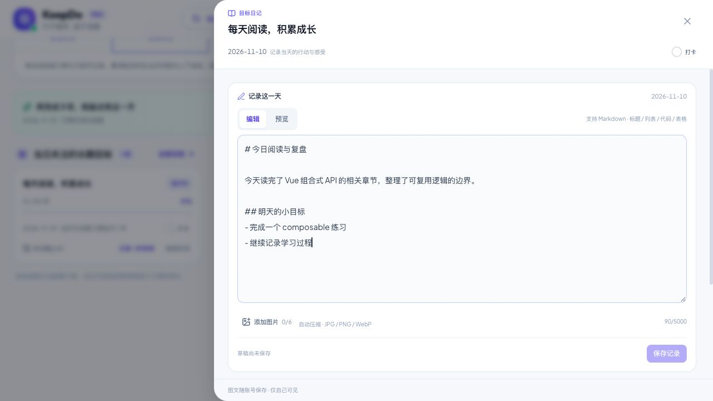

# KeepDo

**每日行动 · 沉淀长期目标**

KeepDo 是一款把长期目标、日常习惯和待办行动放在一起的个人管理工具。从「读完 12 本书」到「每天阅读 30 分钟」，用计划日历安排今天，用打卡记录坚持，用成长时间线留下过程。同一套 Vue 界面提供 Web，以及基于 Tauri 2 的 Windows、macOS、Linux、Android 和 iOS 客户端构建。

[在线体验](https://keepdo.shindouhiro.workers.dev) · [下载与安装](#下载与安装) · [产品截图](#产品截图) · [本地运行](#启动与运行) · [原生开发](#跨平台原生客户端) · [Chrome 扩展](#chrome-扩展实验性) · [部署说明](#部署到-cloudflare) · [版本发布](#版本发布与补传安装包) · [常见问题](#常见问题)


## 下载与安装

直接使用 [Web 版](https://keepdo.shindouhiro.workers.dev) 即可注册账号、管理目标和记录日记，无需安装开发工具。桌面和移动客户端连接同一线上服务，使用同一个 KeepDo 账号；首次打开客户端仍需登录，浏览器的登录状态不会自动复制到原生客户端。

### 选择正确的安装包

打开 [最新 Release](https://github.com/shindouhiro/KeepDo/releases/latest)，展开页面底部的 **Assets**，下载与你的设备匹配的文件。普通用户下载 Release 安装包即可，**不需要安装 Node.js、pnpm、Rust 或克隆仓库**。

下表以 [v1.0.2](https://github.com/shindouhiro/KeepDo/releases/tag/v1.0.2) 为文件名和下载链接示例；后续版本请在最新 Release 中选择对应的新版本文件。

| 设备 / 用途 | 文件名示例与下载 | 使用条件 |
| --- | --- | --- |
| Mac，Apple Silicon（M 系列芯片） | [KeepDo_1.0.2_macos_arm64.dmg](https://github.com/shindouhiro/KeepDo/releases/download/v1.0.2/KeepDo_1.0.2_macos_arm64.dmg) | macOS 14.4 及以上 |
| Mac，Intel 芯片 | [KeepDo_1.0.2_macos_x64.dmg](https://github.com/shindouhiro/KeepDo/releases/download/v1.0.2/KeepDo_1.0.2_macos_x64.dmg) | macOS 14.4 及以上 |
| Windows，x64 | [KeepDo_1.0.2_windows_x64_setup.exe](https://github.com/shindouhiro/KeepDo/releases/download/v1.0.2/KeepDo_1.0.2_windows_x64_setup.exe) | 需要可用的 WebView2 Runtime；当前不提供 Windows ARM64 原生包 |
| Linux，x64，AppImage | [KeepDo_1.0.2_linux_x64.AppImage](https://github.com/shindouhiro/KeepDo/releases/download/v1.0.2/KeepDo_1.0.2_linux_x64.AppImage) | 需要兼容的系统运行库与桌面密钥环 |
| Linux，Debian / Ubuntu 系，amd64 | [KeepDo_1.0.2_linux_amd64.deb](https://github.com/shindouhiro/KeepDo/releases/download/v1.0.2/KeepDo_1.0.2_linux_amd64.deb) | 使用系统包管理器安装并解析依赖 |
| Android，arm64 手机 | [KeepDo_1.0.2_android_arm64_debug.apk](https://github.com/shindouhiro/KeepDo/releases/download/v1.0.2/KeepDo_1.0.2_android_arm64_debug.apk) | 最低 Android API 24（Android 7.0），保持系统 WebView 更新；调试签名 |
| iOS，Apple Silicon Mac 上的模拟器 | [KeepDo_1.0.2_ios_arm64_simulator.zip](https://github.com/shindouhiro/KeepDo/releases/download/v1.0.2/KeepDo_1.0.2_ios_arm64_simulator.zip) | 需要 Xcode 与 iOS 17.4+ 模拟器；不能安装到 iPhone / iPad 真机 |
| Chrome 新标签页 / 侧栏 | [dist-extension.zip](https://github.com/shindouhiro/KeepDo/releases/latest/download/dist-extension.zip) | 按 [Chrome 扩展说明](#chrome-扩展实验性) 加载 |
| 原生包完整性校验 | [SHA256SUMS-native.txt（v1.0.2）](https://github.com/shindouhiro/KeepDo/releases/download/v1.0.2/SHA256SUMS-native.txt) | 与安装包下载自同一版本，仅包含原生附件的哈希 |

`arm64` 与 `x64 / amd64` 表示处理器架构。Mac 可在「 → 关于本机」查看芯片；M 系列选择 `macos_arm64`，Intel 选择 `macos_x64`。Android 当前只提供 arm64 APK，不适用于 x86 模拟器。

| 下载位置 / 文件 | 含义 |
| --- | --- |
| Release 的 DMG、EXE、APK、AppImage、DEB | 可以安装或运行的客户端文件，公开仓库下载无需登录 GitHub |
| Release 的 `Source code (zip)` / `Source code (tar.gz)` | GitHub 自动生成的源码压缩包，不是安装包 |
| Actions 的 Artifacts | 某次构建的中间分发产物，通常需要登录 GitHub；原生包保留 14 天 |
| iOS 模拟器 ZIP | 包含模拟器归档的压缩文件，不是可供真机安装的 IPA |

当前原生安装包用于测试：Windows/macOS 尚未配置正式发行签名或 macOS 公证，Android 使用调试签名；暂未上架 Microsoft Store、Mac App Store、Google Play 或 App Store。

### macOS 安装

1. 下载对应芯片的 DMG，双击挂载。
2. 将 `KeepDo.app` 拖入「应用程序」，复制完成后推出磁盘映像。
3. 从「应用程序」打开 KeepDo，注册或登录账号。
4. 若系统因开发者验证而拦截，先确认来自本仓库 Release 并 [校验安装包](#校验安装包)。对确认可信的测试包，可按 [Apple 的打开应用说明](https://support.apple.com/en-us/102445)，在尝试打开后到「系统设置 → 隐私与安全性」查看是否有「仍要打开」选项。受组织策略限制或没有此选项时，可先使用 Web 版。

出现「应用程序已损坏」时，先重新下载并检查哈希、系统版本及芯片架构；不要把关闭系统整体安全检查作为安装步骤。

### Windows 安装

1. 下载 `*windows_x64_setup.exe`，运行安装向导并选择安装位置。
2. 按向导完成安装，从开始菜单或桌面快捷方式启动。
3. 如果提示缺少 WebView2，安装 [微软官方 WebView2 Evergreen Runtime](https://developer.microsoft.com/en-us/microsoft-edge/webview2/)，然后重新启动 KeepDo。联网安装器与独立安装器均由该页面提供。
4. 若出现未知发布者或 SmartScreen 提示，请核对 Release 来源与校验和；当前测试包没有正式发行签名，单位设备的安装策略可能阻止运行，可使用 Web 版。

### Linux 安装

AppImage：下载后赋予执行权限，再运行。下面命令在下载目录执行，文件名按实际版本替换：

```bash
chmod +x KeepDo_1.0.2_linux_x64.AppImage
./KeepDo_1.0.2_linux_x64.AppImage
```

DEB：在使用 APT 的 Debian / Ubuntu 系统中，进入下载目录执行：

```bash
sudo apt install ./KeepDo_1.0.2_linux_amd64.deb
```

安装后通过桌面应用菜单打开。Linux 包在 Ubuntu 22.04 CI 中构建，尚未覆盖所有发行版的运行验证；WebKitGTK、图形环境、系统库或 FUSE 不兼容时需按发行版处理。AppImage 遇到 FUSE 问题时，也可在兼容系统中选择 DEB。

登录需要可用且已解锁的 Secret Service 密钥环，例如 GNOME Keyring，或提供相应服务的 KWallet 环境。只有命令行、未启动桌面会话或未解锁密钥环时，可能出现「无法安全保存登录凭据」。

### Android 安装

1. 在 arm64 Android 手机上下载 `*android_arm64_debug.apk`。
2. 从下载通知或文件管理器打开 APK，按系统提示允许当前浏览器 / 文件管理器安装该应用。Android 8.0 及以上按来源分别授权，入口因系统而异，见 [Android 官方分发说明](https://developer.android.com/distribute/marketing-tools/alternative-distribution)。
3. 安装完成后打开 KeepDo 并登录；需要网络连接与可用的系统 WebView。
4. 手机端导出记录时使用「保存 PNG」后分享；当前暂不支持直接复制图片到剪贴板。

调试 APK 仅用于测试。不同 CI 构建可能使用不同调试证书，覆盖安装时可能提示签名不一致；先确认账号已保存并导出完整备份，再卸载旧测试版、安装新包并重新登录。正式发布需要固定的发布签名，配置见 [原生客户端指南](docs/native.md#android-初始化与签名)。

### iOS 模拟器与真机说明

当前 Release **没有可直接安装到 iPhone / iPad 的 IPA**。`*ios_arm64_simulator.zip` 面向使用 Apple Silicon Mac 和 Xcode 的开发者，不能通过改后缀变成真机包。

在 Xcode 中准备并启动 iOS 17.4 或更新版本的模拟器，解压 ZIP，在 `.xcarchive/Products/Applications/` 下找到 `KeepDo.app`，将它拖入已启动的模拟器窗口即可安装。也可在终端执行，替换为实际解压路径：

```bash
xcrun simctl install booted "/实际解压目录/build/keepdo_iOS.xcarchive/Products/Applications/KeepDo.app"
xcrun simctl launch booted dev.keepdo.client
```

真机测试、TestFlight 和 App Store 分发需要 Apple 开发者团队、证书、描述文件及相应签名流程，详见 [iOS 初始化与签名](docs/native.md#ios-初始化与签名)。

### 校验安装包

下载与安装包同一 Release 的 `SHA256SUMS-native.txt`。在下载目录计算对应文件的 SHA-256，与清单中同名文件那一行比较；文件名、版本和哈希应一致：

```bash
# macOS 示例
shasum -a 256 KeepDo_1.0.2_macos_arm64.dmg

# Linux 示例
sha256sum KeepDo_1.0.2_linux_x64.AppImage
```

Windows PowerShell 示例：

```powershell
Get-FileHash .\KeepDo_1.0.2_windows_x64_setup.exe -Algorithm SHA256
```

校验和用于核对下载内容是否与发布附件一致，不代表安装包已获得系统签名或公证。

### 升级、同步与卸载

1. 升级前确认顶部状态为「已保存到账号」，并在「设置与数据管理」导出一次完整备份。
2. 退出旧版，下载正确架构的新版安装包，按对应平台步骤更新。当前没有桌面自动更新功能。
3. 打开新版，必要时重新登录同一账号。原生登录与 Web 登录独立，但读取同一服务器中的账号数据。
4. 退出登录或卸载客户端不会主动删除云端账号数据；未同步的修改和未保存草稿不能依赖重装恢复。

客户端需要联网，暂不提供完整离线数据库与离线编辑同步。手机和电脑同时修改发生冲突时，先导出当前内容备份，再刷新读取云端最新版本。完整备份包含日记和照片，请保存在可信位置。

## 核心功能

| 功能 | 你可以做什么 |
| --- | --- |
| 长期目标 | 用天数、数值或里程碑衡量进度，按分类管理目标，查看截止日与剩余天数 |
| 计划日历 | 切换周/月视图，滚动查看每天全部计划，切换卡片详情，收起日历，查看日期进度环与全部事项 |
| 快捷收集 | 任意主页面点击「快捷添加」或按 `⌘ / Ctrl + K`，设置日期、优先级并关联长期目标 |
| 行动成就 | 完成当日习惯与待办点亮日期，积累近七天完整达成日，获得行动徽章 |
| 习惯与待办 | 为习惯编写描述，一键打卡、查看连续天数，为待办设置优先级并关联长期目标 |
| 目标与习惯日记 | 用 Markdown、代码高亮和图片记录进展，支持粘贴截图、编辑预览切换与当日记录回看 |
| 记录时间线 | 按目标、习惯及日期筛选全部图文记录，导出 SVG / PNG 长图或复制高清图片 |
| 统计复盘 | 查看近 12 周行动热力图、习惯打卡次数、最长连击与目标进度 |
| 账号与数据 | 注册登录、跨设备读取账号数据，通过 JSON 完整备份与恢复基础数据、图文日记及图片 |
| GitHub 异地备份 | 连接私有仓库，手动保存完整快照，分页查看历史并确认恢复 |
| 原生客户端 | 共用云端账号与数据，使用系统安全凭据存储、文件保存对话框、图片导出与退出草稿保护 |
| Chrome 扩展（实验性） | 在新标签页或侧栏打开线上工作区，提供连接检查、重试与网页入口 |
| 深浅主题 | 跟随系统初始化主题，也可手动切换；界面适配桌面与移动端 |

## 产品截图

以下截图来自本地运行的 KeepDo，使用独立演示账号与示例数据。截图中的进度、记录和统计仅用于展示产品。

### 今日专注：把目标落到每一天

计划日历按日期展示长期目标、日常习惯与待办，支持周、月视图切换和指定日期跳转。日历下方集中展示当日关注的目标、习惯打卡和待办清单，方便安排与执行当天的行动。

日历的周、月视图都包含每天全部计划，事项较多时在当天列表内上下滚动，目标与习惯卡片显示「写记录」或「记录 / 时间线」，单击即可为对应日期写记录，双击也会保持记录弹窗打开。「紧凑卡片」最多预览两行标题，「完整卡片」展示完整标题；两种模式都保留全部事项。「日程详情」可集中查看和编辑当天安排。日历可收起为所选日期摘要，手机端支持横向滑动，切换日期时让所选日期保持在可见区域。日期进度环、完成数字及绿色勾选共同表达状态，不依赖颜色判断。

桌面宽屏（1280px 起）将目标、习惯和待办分为三栏，工作区最多 1440px；手机和平板保持纵向阅读。顶部「快捷添加」在今日、目标、记录和统计页均可用，默认安排在今天，也可改为其他日期；快捷键为 `⌘ / Ctrl + K`，编辑输入或已有弹窗打开时不会触发。保存失败会保留草稿供重试，重试不会重复添加。

所有应用弹出界面统一为抽屉式：目标、习惯、待办编辑、日程详情、设置、日记、图片大图、记录长图预览及各类确认均从右侧全高展开，窄屏铺满屏幕。表单和设置在内部滚动，关闭与底部保存操作保持可见；支持 Escape、键盘焦点约束和关闭后返回触发入口。备份恢复、示例数据重置、账号数据覆盖和 GitHub 断开也使用确认抽屉，取消后保留原数据。

「行动成就」显示所选日期的习惯与待办进度，以及截至今天的近七天完整达成天数：1 天解锁「行动启程」、3 天「稳步前行」、7 天「七日之星」。这些是滚动七天内的累计天数，无需连续；空计划与未来日期不计入徽章。徽章直接由当前记录计算，撤销完成、增删计划后会同步更新。每日全部完成会触发现有庆祝动画，系统开启「减少动态效果」时不播放。当前提供应用内快捷收集与轻量徽章；Chrome 扩展已有实验性打包入口，使用限制见下文。系统级快捷键、可拖拽面板及代币/盲盒仍为后续方向。

- 点击日期，查看目标说明、里程碑、习惯记录和待办全文，也能直接完成、编辑或添加事项。
- 待办支持高、中、低优先级，以及全部、未完成、已完成筛选。
- 目标支持当天打卡与历史补卡，点击已打卡可撤销，未来日期暂不能打卡。
- 日历中，当天已打卡的目标、已完成的习惯与待办卡片统一显示为绿色，并保留勾选和状态文字；撤销后恢复类型配色。目标累计达成不代表历史每一天都已打卡。


[查看手机端收起日历后的布局](docs/screenshots/issue-1-mobile.jpg)

### 长期目标：选择适合自己的进度方式

上方工作台截图展示了三种目标模型。每张目标卡片都有分类、截止提醒和进度条，还能关联日常习惯。

| 目标模型 | 示例 | 如何推进 |
| --- | --- | --- |
| 数值量化 | 读完 12 本深度好书 | 自定义单位，通过快捷按钮登记累计数量 |
| 天数打卡 | 坚持每日复盘与写作 100 天 | 目标打卡或完成关联习惯，同一天合计累计 1 天 |
| 阶段里程碑 | 上线 KeepDo 个人管理系统 | 将目标拆成阶段，勾选里程碑更新进度 |

数值型与里程碑型目标的日历打卡用于标记当天已行动；累计数量和阶段完成状态分别在目标卡片中更新。当日行动完成率单独统计习惯与待办。

### 目标与习惯日记：记录进展，也留下思考

点击日历中的目标标题，或目标卡片上的「记录 / 时间线」，即可打开目标日记。抽屉仅展示、添加和编辑所选日期的记录，刷新和加载更多也始终限定在当天；其他日期的历史记录可在主导航「记录」中回看。

目标和习惯日记使用右侧全高抽屉，手机端铺满屏幕。顶部信息与底部保存状态固定，编辑器和当日记录独立于主页面滚动；打开后可直接输入，编辑已有记录或「再记一笔」会自动定位输入框。关闭时如有未保存的草稿，会先提示确认。

习惯同样支持图文日记：在「管理日常习惯」中填写固定描述，点击习惯标题、卡片上的「记录 / 时间线」，或日历中的习惯，即可为所选日期添加文字和图片。日期详情也提供记录入口，有记录的日期会显示标记。日记独立保存，写记录不会自动完成习惯打卡。

主导航的「记录」将当前账号的目标、习惯图文记录集中为一条时间线，按记录日期从新到旧展示，并标注各条记录的来源。支持「全部 / 目标 / 习惯」筛选；选择类型后可进一步筛选具体目标或习惯。日期可快捷选择「全部日期 / 今天 / 昨天 / 最近 7 天 / 最近 30 天 / 本周 / 本月」，也可手动设置开始、结束日期（包含当天）；最近 7 / 30 天包含今天，本周从周一、本月从 1 日算至今天。支持加载更早记录和图片大图预览。

筛选后点击「保存为图片」，会自动读取全部匹配记录，无需手动加载历史分页。全部内容合并为一张完整长图，带有筛选摘要、来源与日期，完整展开 Markdown 正文和照片。默认提供 SVG 矢量格式，文字与线条可在浏览器中放大查看；照片清晰度取决于原图。也可切换 PNG 高清格式：普通长图按三倍分辨率生成，超长内容自动等比调整尺寸以保留完整内容。点击「复制到剪贴板」可直接复制已生成的 PNG，粘贴到聊天或文档；浏览器不支持或权限不足时显示提示，仍可下载。生成期间可取消，网络或照片加载失败后可重试。图片在当前浏览器中生成，关闭预览后释放临时图片。

错误记录可在时间线或编辑表单中删除。点击删除后需再次确认，文字和图片会一起移除；取消则保留原记录。删除不会改变目标、习惯或打卡状态，同一天还有其他记录时，日历上的记录标记会保留。

每条记录支持最多 5,000 字和 6 张图片，图片支持 JPG、PNG、WebP，上传前自动压缩；文字和图片也可以单独保存。除了点击「添加图片」选择文件，也可以复制截图或图片，在日记编辑器内按 `⌘ / Ctrl + V` 直接添加；粘贴的图片同样支持预览、移除和保存，普通文字粘贴保持原有行为。

记录文字支持 Markdown：标题（`# 标题`）、加粗（`**重点**`）、斜体、删除线、有序与无序列表、引用（`> 感想`）、行内代码、围栏代码块、链接、图片及表格。在编辑器中点击「预览」查看排版，切回「编辑」继续修改；也可按 `Ctrl + E` 在编辑与预览之间切换，返回编辑时恢复输入焦点并保留光标位置；保存后，目标 / 习惯日记和「记录」时间线会统一渲染。代码块支持深浅主题语法高亮，可在三个反引号后标注 `js`、`jsx`、`ts`、`tsx`、`html`、`vue`、`css`、`json`、`python`、`sql`、`bash` 或 `yaml`；未标注时自动识别，未知语言及 `text` / `plaintext` 按纯文本显示。内容保留 Markdown 原文，重新编辑和完整备份仍使用原文；普通文字的换行会保留。原始 HTML 按文字显示，危险链接会被拦截。



更多近期功能截图：

| 功能 | 桌面端 | 移动端 / 深色主题 |
| --- | --- | --- |
| 日记 Markdown 与代码高亮 | [编辑与预览](docs/screenshots/journal-highlight-desktop.png) | [深色主题](docs/screenshots/journal-highlight-mobile-dark.png) |
| 日记粘贴截图 | [粘贴图片](docs/screenshots/journal-paste-desktop.png) | [手机端编辑器](docs/screenshots/journal-paste-mobile.png) |
| 记录快捷日期筛选 | [日期范围](docs/screenshots/records-date-presets-desktop.png) | [手机端筛选](docs/screenshots/records-date-presets-mobile-dark.png) |
| 记录长图与高清复制 | [图片预览与复制](docs/screenshots/records-hd-copy-desktop.png) | [深色主题预览](docs/screenshots/records-hd-copy-mobile-dark.png) |
| 日程详情与当日记录 | [日期详情抽屉](docs/screenshots/calendar-day-records-desktop.png) | [手机端日期详情](docs/screenshots/calendar-day-records-mobile.png) |

### 统计复盘：看见持续行动的积累

通过近 12 周的行动热力图观察自己的节奏，结合历史最高连击、累计达成待办、习惯总打卡与长期目标进度，回顾哪些计划正在稳定推进。


## 开始使用

1. 注册账号并登录，创建自己的个人空间。
2. 在「长期目标」中设立目标，选择天数、数值或里程碑模型。
3. 回到「今日专注」，创建关联习惯与待办，通过日历安排每日行动。
4. 完成后打卡，写下目标或习惯日记，再到「统计复盘」回看积累。

想先了解操作，可以在「设置与数据管理」中载入精选示例数据。**完整 JSON 备份包含目标、习惯（含固定描述）、待办、分类、历史打卡，以及全部目标 / 习惯图文日记和图片原文件，包括已删除主体的历史日记，不受时间线分页影响。恢复完整备份会替换当前账号的全部这些数据，请先备份。** 旧版 JSON 仍可导入，仅替换基础数据并保留账号原有日记与图片；载入示例也只替换基础数据。

完整导出需要联网读取云端日记与图片，任何图片读取失败或导出期间账号内容发生变化都会提示重试，不会下载缺少图片的文件。网络异常时可选择「仅导出页面基础数据」抢救当前页面未保存的修改，此文件明确不含图文日记和图片。完整备份使用带版本的 JSON 格式，图片内嵌为 Base64，恢复时校验格式、图片大小与类型；基础数据、日记和图片在同一次数据库事务中保存，版本冲突时拒绝覆盖。当前恢复入口支持小于 89 MB 的备份文件；请保留原始备份文件。

### 常用快捷键

| 快捷键 | 使用位置 | 操作 |
| --- | --- | --- |
| `⌘ / Ctrl + K` | 今日、目标、记录、统计页 | 打开快捷添加；输入文字或已有抽屉打开时不触发 |
| `Ctrl + E` | 日记编辑器 | 切换编辑与 Markdown 预览，返回编辑时保留光标位置 |
| `⌘ / Ctrl + V` | 日记编辑器 | 粘贴剪贴板中的图片，普通文字仍按原方式粘贴 |
| `Escape` | 已打开的抽屉 | 关闭当前抽屉；有未保存草稿时先确认 |

## 🛠️ 技术选型

- **Vue 3**：Composition API (`<script setup>` + TypeScript)
- **Vite 8**：极速构建与开发体验
- **Tailwind CSS v4**：现代轻量原子样式系统，深浅主题自适应
- **Pinia**：响应式状态管理与账号数据同步
- **Cloudflare Workers + D1**：账号认证、同源 API 与持久化数据库
- **Tauri 2 + Rust**：桌面与移动客户端、固定来源请求桥及系统安全凭据存储
- **Zod**：前后端共享的数据校验与备份格式校验
- **Markdown-it + Highlight.js**：日记 Markdown 渲染与代码语法高亮
- **HTML-to-image**：记录长图生成，支持 SVG、PNG 和剪贴板复制
- **Lucide Icons**：简洁精致的线性矢量图标库
- **Canvas Confetti**：激励仪式感微动效

---

## 启动与运行

本地开发建议使用 **Node.js 24 LTS 与 pnpm 10**；当前本地核对环境为 Node.js 24.11.0、pnpm 10.33.0。构建依赖要求 Node.js 22.12 及以上，测试脚本直接运行 TypeScript，使用建议版本即可免去额外转译配置。项目采用 pnpm workspace，并通过 Catalogs 管理部分依赖版本。

以下命令供源码开发者使用。仅运行 Web 前后端不需要安装 Rust；构建原生客户端时再准备对应平台环境。

```bash
# 获取源码，进入项目根目录
git clone https://github.com/shindouhiro/KeepDo.git
cd KeepDo

# 安装依赖
pnpm install --frozen-lockfile

# 一条命令启动前后端（清理端口、迁移本地数据库、构建资源，等待 API 就绪后启动前端）
pnpm dev

# 按 Ctrl+C 同时停止前后端

# 按需单独启动前端或后端
pnpm dev:web
pnpm dev:api

# 构建生产版本（含前端与 Worker 类型检查）
pnpm build

# 本地预览完整生产应用（含 API）
pnpm dev:api
```

启动后访问 Vite 输出的本地地址，默认是 [http://localhost:5173](http://localhost:5173)。本地数据库与线上 D1 分离，首次使用需要在本地注册账号。

`pnpm dev` 会先清理占用 `5173`、`8787` 的进程及相关开发进程；也可执行 `pnpm clean:ports` 单独清理。当前清理脚本使用 `lsof` 和 `ps`，适用于提供这些命令的开发环境。

前端 `/api` 请求代理到 `localhost:8787`。单独运行 `pnpm dev:web` 时，需要另开终端运行 `pnpm dev:api`；首次单独启动后端前，先执行 `pnpm db:migrate:local` 和 `pnpm build:cloudflare`。

Windows，或不希望运行端口清理脚本时，可分别启动两个终端：

```bash
# 终端一：准备本地数据库和资源，然后保持 API 运行
pnpm db:migrate:local
pnpm build:cloudflare
pnpm dev:api
```

```bash
# 终端二：启动前端
pnpm dev:web
```

| 地址 / 端口 | 提供什么 | 使用方式 |
| --- | --- | --- |
| `http://localhost:5173` | Vite 热更新前端 | 浏览器日常开发；API 经代理访问 8787 |
| `http://localhost:8787` | Worker API 与已构建的静态页面 | 本地账号、数据库与完整生产构建预览 |
| `http://localhost:8787/api/health` | 健康检查 | 正常返回 `{"status":"ok"}` |

本地账号与数据位于 Wrangler 的本地 D1 状态中；它们不与线上数据库同步。切换到本地后看不到线上数据属于环境隔离，需要注册本地测试账号，或按需导入自己的备份。

`pnpm preview` 仅预览静态前端，不提供账号与数据 API。要验证完整生产构建，构建后运行 `pnpm dev:api`，访问 [http://localhost:8787](http://localhost:8787)。

## Chrome 扩展（实验性）

仓库提供 Manifest V3 扩展源码，可在 Chrome 新标签页和侧栏中使用 KeepDo。点击扩展图标时，后台脚本会尝试切换到已有的 KeepDo 扩展标签页，否则新建标签页；右键点击扩展图标，选择「Open Side Panel」可打开侧栏。

扩展通过内嵌线上 KeepDo 提供工作区，账号登录、数据同步和图片仍由同一个 Workers 服务处理，需要联网使用。仅申请 KeepDo 站点访问权限与侧栏权限，不读取 Cookie，也不需要访问其他网站。默认连接 [KeepDo 在线站点](https://keepdo.shindouhiro.workers.dev)，可复用该站点已有登录状态。

打开时先检查 `/api/health`，再加载线上工作区；连接超过 20 秒会显示超时提示，失败或超时可点击「重新连接」。顶部提供「重新加载」和「在网页中打开」入口，重新加载交由浏览器处理；有未保存内容时，请留意页面的离开提醒。

```bash
# 安装依赖后，生成扩展目录与分发压缩包
pnpm build:extension
```

构建输出为 `dist-extension/` 和 `dist-extension.zip`。压缩打包依赖系统 `zip` 命令；若压缩失败，仍可加载已生成的目录。该命令通过独立 Vite 配置构建扩展连接界面，不会把业务前端和 Worker 打进扩展；类型检查与主应用构建仍使用 `pnpm build`。

推荐从仓库右侧的 **Releases** 下载已发布的安装包，无需登录 GitHub 或在本地安装依赖：

1. 打开 [最新版本](https://github.com/shindouhiro/KeepDo/releases/latest)，在 **Assets** 中下载 [dist-extension.zip](https://github.com/shindouhiro/KeepDo/releases/latest/download/dist-extension.zip)。
2. 将 ZIP 解压到固定目录，再按照下方步骤加载包含 `manifest.json` 的目录。

开发版本也可以从 GitHub Actions 下载：

1. 打开 [Build Chrome Extension 工作流](https://github.com/shindouhiro/KeepDo/actions/workflows/extension.yml)，选择一次成功运行。
2. 在该次运行的 **Artifacts** 区域下载 `dist-extension.zip`（需要登录 GitHub，产物保留 30 天）。
3. 将 ZIP 解压到固定目录，再按照下方步骤加载包含 `manifest.json` 的目录。

工作流在推送到 `main`、提交面向 `main` 的 Pull Request 时自动运行，也支持通过 **Run workflow** 手动触发。它会先运行单元测试，再构建并检查 ZIP 完整性；打包或上传产物失败会使工作流失败。安装包以原始 ZIP 上传，下载后只需解压一次。

扩展与原生客户端共用项目版本与 `vX.Y.Z` 标签。维护者的版本更新、自动打包和附件补传步骤统一见 [版本发布与补传安装包](#版本发布与补传安装包)。

本地加载步骤：

1. 在 Chrome 地址栏输入 `chrome://extensions/`，打开「开发者模式」。
2. 点击「加载已解压的扩展程序」，选择仓库中的 `dist-extension/` 目录，或上方安装包解压后包含 `manifest.json` 的目录。
3. 打开新标签页，或点击扩展图标检查入口。修改源码并重新构建后，在扩展管理页点击重新加载。

升级旧版时，先重新执行 `pnpm build:extension`，再到扩展管理页重新加载 KeepDo，并关闭旧的扩展页面后重新打开。安装扩展不会在本地创建另一套账号或数据库，默认使用线上账号与数据。

| 遇到的问题 | 处理方式 |
| --- | --- |
| 提示服务无法访问或连接超时 | 点击「在网页中打开」检查目标站点是否可访问，网络恢复后点击「重新连接」 |
| 旧版仍停留在账号服务错误页 | 重新构建并加载 `dist-extension/`，确认扩展管理页版本与本次下载的 Release 一致，再重新打开新标签页或侧栏 |
| 网页可访问，内嵌工作区仍无法使用 | 先通过「在网页中打开」继续使用；自建部署需检查站点是否允许被内嵌 |
| 没有生成压缩包 | 检查系统 `zip` 命令；可直接加载已生成的 `dist-extension/` 目录 |

如需连接自己的部署，同时修改 `extension/manifest.json` 中的 `homepage_url`、`host_permissions` 以及 CSP 的 `frame-src` / `connect-src`，将它们限定为同一个 HTTPS 站点，再重新构建并加载。目标站点必须允许被内嵌，且提供兼容的 `/api/health` 接口。

## 项目结构

```text
KeepDo/
├── src/
│   ├── components/       # 今日专注、目标、记录、统计、账号与备份界面
│   ├── composables/      # 日记、抽屉、快捷添加、备份与记录图片导出
│   ├── stores/           # Pinia 业务数据、账号与日记状态
│   └── lib/              # API、Markdown、图片压缩与跨平台网络/文件/剪贴板适配
├── src-tauri/            # Rust 请求桥、系统凭据存储、权限、图标与平台配置
├── server/
│   ├── migrations/       # D1 数据库迁移
│   ├── auth.ts           # 账号认证、Web Cookie 与独立原生会话
│   ├── native.ts         # 原生请求标识与 Bearer 格式校验
│   ├── journal.ts        # 目标、习惯日记与图片接口
│   ├── backup.ts         # 完整备份导出与事务恢复
│   └── github-backup.ts  # 私有仓库连接、快照与历史恢复
├── shared/               # 前后端共用的数据校验、日历与打卡逻辑
├── extension/            # 实验性 Chrome 扩展连接界面、清单、后台脚本与图标
├── scripts/              # 开发端口清理、扩展打包与原生构建/签名配置脚本
├── .github/workflows/    # Web 静态发布、扩展及多平台原生构建
├── tests/                # 单元测试与 API 集成测试
├── docs/plans/           # 功能设计与实现计划
├── docs/screenshots/     # README 产品实拍截图
├── docs/native.md        # 原生开发、打包、签名与分发指南
├── pnpm-workspace.yaml   # Workspace 与 Catalogs 依赖版本管理
├── vite.extension.config.ts # 扩展连接界面的独立构建配置
└── wrangler.jsonc        # Cloudflare Workers 与 D1 配置
```

## 部署到 Cloudflare

本项目通过 Cloudflare Workers 托管前端静态资源与同源 `/api/*` 接口，通过 D1 持久保存账号、会话及业务数据，部署设置保存在 `wrangler.jsonc`。`pnpm build:cloudflare` 使用根路径资源地址，普通 `pnpm build` 保留 GitHub Pages 所需的相对路径。

线上地址：[KeepDo](https://keepdo.shindouhiro.workers.dev)。

### 首次部署到自己的账户

1. 准备 Cloudflare 账户，在本地完成 `pnpm install --frozen-lockfile`。
2. 执行 `pnpm cf:login` 在浏览器授权，再用 `pnpm cf:whoami` 确认目标账户。
3. 在目标账户创建 D1：`pnpm exec wrangler d1 create keepdo-db`。如果已有该项目的数据库，应复用它。
4. 将命令返回的实际数据库 ID 写入 `wrangler.jsonc` 的 `d1_databases[0].database_id`；保留绑定名 `DB` 和 `migrations_dir`。仓库中已有的 ID 属于当前线上环境，不能直接用于另一个账户。
5. 按需调整 Worker 的 `name`；修改数据库名称时也要同步 `package.json` 中两个 `db:migrate:*` 脚本使用的名称。
6. 执行 `pnpm deploy:check`，通过后执行 `pnpm run deploy`。首次发布会应用全部未执行的迁移，后续发布只应用新增迁移。
7. 打开发布终端返回的实际 HTTPS 地址，检查页面及 `/api/health`，再注册该部署中的账号。

自己的部署与 KeepDo 默认站点拥有独立数据库和账号。已有原生安装包仍连接编译时固定的默认服务；连接自己的服务需要 [重新编译原生客户端](#连接自己的服务)，仅部署网页不会改变已安装客户端的服务器。

### 日常更新与部署命令

```bash
# 首次部署：在浏览器完成 Cloudflare 授权
pnpm cf:login

# 检查当前账户
pnpm cf:whoami

# 构建并检查部署配置，不上传
pnpm deploy:check

# 需要单独更新线上数据库时，可手动应用迁移
pnpm db:migrate:remote

# 构建、自动应用线上数据库迁移并发布，成功后终端会返回实际访问地址
pnpm run deploy
```

`pnpm run deploy` 会先完成构建，再执行尚未应用的 D1 迁移，最后发布 Worker；任一步失败都会停止发布。`pnpm deploy:check` 仅检查构建和配置，不会更新线上数据库。请使用完整发布命令：单独运行 `wrangler deploy` 不会执行数据库迁移，可能导致日记保存、图片上传和时间线读取因缺少表或字段而返回 500。

请保留命令中的 `run`：`pnpm deploy` 是 pnpm 自带的工作区部署命令，不会运行本项目的发布脚本。Cloudflare 负责托管 Web、API 和 D1 数据；原生安装包由本机或 GitHub Actions 构建后单独分发。原生客户端还需要 `0008_native_sessions.sql` 与 `/api/native/*` 路由，均已于 2026-11-13 部署至上述线上站点；自建部署请运行完整发布流程。

当前发布更新同名 `keepdo` Worker，数据库绑定 `DB` 指向 `keepdo-db`。换账户部署时先创建目标 D1，再将实际 database_id 写入配置，不能沿用其他账户的数据库 ID。多账户时，部署前通过 `CLOUDFLARE_ACCOUNT_ID` 指定目标账户。令牌不应写入仓库。

旧版本地数据不会自动上传。登录后可点击「导入旧数据」迁移当前浏览器的数据，或在设置中导入原站导出的 JSON；导入会替换当前账号数据，原始旧本地数据保留。当前版本支持用户名密码注册、登录及退出，暂不提供密码找回。

## 账号与同步

- 用户名为 3–32 位字母、数字或下划线，不区分大小写；密码为 10–128 位。密码使用独立随机盐与原生 scrypt 保存摘要，Web 登录使用 HttpOnly Cookie；原生登录使用独立的 30 天 Bearer 会话，由 Rust 直接存入系统安全凭据存储，令牌不进入 WebView 或 localStorage。
- 数据库按服务端会话中的用户 ID 查询，客户端不能指定其他账号。数据库写入使用版本检查，另一台设备已修改时返回冲突，避免静默覆盖。
- 页面顶部显示保存状态。保存失败时保留当前页面并重试；发生冲突时先在设置中导出备份，再刷新云端内容。未保存时关闭页面会提示。
- 切回页面时，在没有本地未保存修改的情况下刷新云端数据；不是多人实时协作服务。
- 本版本需要 Workers API，GitHub Pages 工作流仅能托管前端文件，不能单独提供完整账号功能。

### GitHub 异地备份

在「设置与数据管理 → GitHub 异地备份」中连接独立的私有仓库。当前支持手动备份、历史分页和指定版本恢复；日常数据仍保存在 Cloudflare，尚不提供定时备份或双向自动同步。

页面手动授权（无需配置服务端密钥）：

1. 打开「设置与数据管理 → GitHub 异地备份」，按页面步骤创建细粒度令牌并填写仓库所有者、私有仓库名和令牌。
2. 点击「验证并连接私有仓库」，随后可直接备份、查看历史和恢复。
3. 未配置服务端密钥时，令牌仅保留在当前设置面板的内存中，经同源 POST 交给后端用于当前 GitHub 请求，不写入数据库、浏览器存储或 URL。关闭设置、刷新或断开后需重新授权；原仓库历史仍可读取。

部署者如需启用授权持久保存：

1. 应用数据库迁移 `0007_github_backup.sql`（本地运行 `pnpm db:migrate:local`，线上随 `pnpm run deploy` 自动执行）。
2. 生成至少 32 字符的随机密钥，通过 `pnpm exec wrangler secret put GITHUB_BACKUP_SECRET` 在交互提示中录入。不要将密钥写入源码。本地开发可将 `GITHUB_BACKUP_SECRET=你的随机密钥` 放入已被 Git 忽略的 `.dev.vars`。
3. 发布后在设置中连接仓库。配置密钥后使用加密保存授权；未配置时仍可使用上述页面手动授权。

用户连接时：

1. 在 GitHub 创建专用私有仓库（建议初始化 README），并创建 [细粒度访问令牌](https://github.com/settings/personal-access-tokens/new)。仅选择该仓库，将 **Contents** 设为 **Read and write**；无需授予 Workflows 或其他仓库权限。
2. 填写仓库所有者、仓库名和令牌，点击「验证并连接私有仓库」。页面会说明授权保留方式：本次页面有效，或配置密钥后按账号用 AES-GCM 加密存入 D1。接口不会返回令牌，业务备份也不包含连接配置或凭据。部署者变更服务端密钥后需重新连接。
3. 点击「立即备份到 GitHub」。完整 JSON 写入 `keepdo/<KeepDo 账号 ID>/backup.json`，每次提交保留一个历史版本。历史列表每页 10 条，恢复前展示目标、习惯、待办、图文记录和图片数量并再次确认；恢复沿用现有版本冲突保护。

**GitHub 单次完整备份上限为 8 MB**（UTF-8 文件字节数），以控制 Worker 校验和 Base64 编码时的内存使用；超限不会上传，请使用本地完整导出。GitHub 备份文件包含明文日记及内嵌图片，不是加密备份；请谨慎授权仓库协作者，不要将仓库改为公开。应用每次访问都会重新校验仓库的私有状态，但无法撤回已公开的历史内容。频繁备份包含图片的文件会增加 Git 仓库体积。

断开连接仅删除当前账号保存的授权，不删除仓库历史文件；令牌过期或权限撤销后可重新连接。上传失败时页面提示错误，当前账号数据不受影响；若 GitHub 已接收提交但网络中断，可先刷新历史确认结果，再决定是否重试。GitHub 文件写入与读取分别使用官方 [Contents API](https://docs.github.com/en/rest/repos/contents)，历史版本使用 [Commits API](https://docs.github.com/en/rest/commits/commits#list-commits)。

## 验证

```bash
# 业务逻辑、日记、Markdown、剪贴板、备份与安全校验测试
pnpm test

# 在 pnpm dev:api 已启动且本地迁移完成后运行真实 API 测试
pnpm test:api

# 单独检查前端与 Worker 类型
pnpm exec vue-tsc -b
pnpm exec tsc -p tsconfig.worker.json

# 检查实验性 Chrome 扩展的构建产物
pnpm build:extension

# 前后端类型检查、生产构建及 Wrangler 配置检查
pnpm deploy:check
```

API 集成测试只默认访问本地环境，会创建专用测试账号；远程验证必须显式指定测试目标。禁止将生产用户密码、会话或 API Token 提交到仓库。

仓库当前的 `.github/workflows/deploy.yml` 发布到 GitHub Pages，仅执行依赖安装、前端构建与静态发布。完整 Workers / D1 应用请使用上述 Cloudflare 部署流程；单元测试与 API 集成测试需另外运行。

## 跨平台原生客户端

原生包内置 Vue 界面，通过 Rust 请求桥连接同一套 Workers/D1，复用线上账号、目标、习惯、待办与图文日记。需要联网使用；首版未包含完整离线编辑、自动冲突合并或桌面自动更新。外部 HTTPS 链接使用系统浏览器打开，正常退出时先处理抽屉草稿与待同步内容。

### 环境与平台要求

| 开发目标 | 需要准备的工具 |
| --- | --- |
| 全部原生平台 | Node.js 24、pnpm 10、Rust stable（至少 1.90），以及同一套 rustup 管理的 cargo/rustc |
| macOS | macOS、完整 Xcode / 对应命令行工具；分别构建 Apple Silicon 与 Intel target |
| Windows | Windows、MSVC Rust 工具链、Visual Studio C++ 构建工具及 WebView2 |
| Linux | Linux 桌面构建环境、WebKitGTK 4.1 开发库、C/C++ 工具链、SSL/DBus 等依赖；运行时需可用的 Secret Service |
| Android | JDK 17、Android SDK、NDK；设置 `JAVA_HOME`、`ANDROID_HOME`、`NDK_HOME` |
| iOS | Apple Silicon Mac、完整 Xcode、相应模拟器运行时与 Rust iOS target；真机包另需开发者团队与签名 |

原生安装包应在相应系统构建。Windows、Linux、macOS 可用 GitHub Actions 矩阵分别打包，不是运行一次本机 `pnpm build:desktop` 就同时生成所有系统安装器。平台依赖的安装方式见 [Tauri 官方环境要求](https://v2.tauri.app/start/prerequisites/)。

当前 Android CI 固定使用 SDK Platform 36、Build Tools 36.0.0、NDK 29.0.14206865 和 JDK 17；本地排查构建差异时先与 `.github/workflows/native.yml` 对齐。

### 桌面开发与本地构建

```sh
# 安装前端依赖，并准备 Rust 与对应平台的开发环境
pnpm install --frozen-lockfile

# 桌面开发，默认连接线上服务
pnpm dev:native

# 已启动本地 API 时，切换为本地开发服务
KEEPDO_API_ORIGIN=http://localhost:8787 pnpm dev:native

# 构建当前桌面平台的安装包
pnpm build:desktop
```

`KEEPDO_API_ORIGIN` 在 Rust 编译时固定；更换服务来源后需重新编译，正式包只接受 HTTPS。Web 构建输出到 `dist/`，原生界面输出到 `dist-native/`；桌面安装包位于 `src-tauri/target/release/bundle/`，指定 Rust target 时位于对应 target 子目录。

| 平台 | 构建入口 | 当前验证状态 |
| --- | --- | --- |
| Web | `pnpm build:cloudflare`，随后按上文部署 | 已部署 Cloudflare，页面、资源与接口验收通过 |
| macOS | `pnpm build:desktop --bundles app,dmg` | Apple Silicon 的 app/DMG 已本机构建并验证核心操作，最低 macOS 14.4 |
| Windows | `pnpm build:desktop --bundles nsis` | x64 CI 安装器构建成功；需要 MSVC 与 WebView2，尚未进行本机运行验收 |
| Linux | `pnpm build:desktop --bundles appimage,deb` | x64 CI 的 AppImage/deb 构建成功；需要 WebKitGTK 4.1 与 Secret Service，尚未进行本机运行验收 |
| Android | 初始化后运行 `pnpm build:android --debug --target aarch64 --apk --ci` | arm64 调试 APK 的 CI 构建成功，尚未进行真机验收；最低 API 24 |
| iOS | 初始化后运行 `pnpm build:ios --debug --target aarch64-sim --no-sign --archive-only --ci` | arm64 模拟器归档已本机构建，最低 iOS 17.4；真机分发需签名 |

### Android 与 iOS 本地构建

Android：配置好上述环境变量后，在项目根目录执行：

```sh
pnpm tauri android init --ci
pnpm build:android --debug --target aarch64 --apk --ci
```

APK 位于 `src-tauri/gen/android/app/build/outputs/apk/` 下的相应子目录。需要连接设备调试时使用 `pnpm dev:android`。正式 APK/AAB 的固定密钥与签名配置见 [Android 初始化与签名](docs/native.md#android-初始化与签名)。

iOS：在具有完整 Xcode 的 Apple Silicon Mac 上执行：

```sh
pnpm tauri ios init --ci
pnpm build:ios --debug --target aarch64-sim --no-sign --archive-only --ci
```

归档位于 `src-tauri/gen/apple/build/`；需要运行调试时使用 `pnpm dev:ios`。构建模拟器包不需要真机签名配置；真机与商店分发仍需 Apple 团队与证书。

Android/iOS 初始化后的工程位于 `src-tauri/gen/`。生成工程、编译缓存、签名密钥和本机配置不提交仓库；不要为解决构建问题删除仍需保留的签名文件。应用标识或最低系统版本变化时，先备份必要的本机配置，再按 [原生客户端指南](docs/native.md) 重新生成工程。

### 连接自己的服务

`KEEPDO_API_ORIGIN` 只填写服务器的 HTTPS 来源，不附加 `/api`，也不包含账号、令牌或密码。它在 Rust 编译时写入安装包，修改网页环境变量或安装后的设置不会改写已经打包的来源。

macOS / Linux Shell 示例，先将示例域名替换为自己的已部署服务：

```sh
KEEPDO_API_ORIGIN=https://your-keepdo.example.com pnpm build:desktop
```

Windows PowerShell 示例：

```powershell
$env:KEEPDO_API_ORIGIN = "https://your-keepdo.example.com"
pnpm build:desktop --bundles nsis
Remove-Item Env:KEEPDO_API_ORIGIN
```

Android/iOS 也要在相应构建命令执行前设置同一变量。发布构建只接受 HTTPS；调试构建仅额外允许本机 `localhost` / `127.0.0.1` 的 HTTP 来源。手机 / 模拟器内的 localhost 不代表开发电脑，默认的本机 API 地址不能直接用于异机设备调试。

自建服务必须已部署 `/api/native/*` 与原生会话迁移。原生登录与 Web Cookie 隔离，系统凭据按服务器来源存储；换服务器后应在新服务中重新注册或登录，不会自动迁移旧服务器的数据。

### 功能边界与验证范围

| 能力 | 当前行为 |
| --- | --- |
| 账号与云端数据 | 多端登录同一服务器中的同一账号可读取同一数据；采用版本检查防止静默覆盖 |
| 凭据保存 | Web 使用 HttpOnly Cookie；原生令牌由 Rust 保存在系统安全凭据存储，界面不接触原生令牌 |
| 备份与记录图片 | 复用完整 JSON 备份及 PNG/SVG 导出；桌面使用系统文件保存对话框 |
| PNG 剪贴板复制 | 桌面支持；Android/iOS 提示先保存 PNG 后分享 |
| 正常关闭与返回 | 桌面关闭 / 菜单退出、Android 返回键先处理当前抽屉和草稿；存在未同步内容时先尝试保存 |
| 离线与更新 | 需要联网，尚无完整离线编辑同步或桌面自动更新 |
| 运行验收 | macOS arm64 已本机验证主要操作；其他原生平台目前已通过 CI 构建，尚未完成对应设备的完整运行验收 |

### 构建产物与公开下载

[原生客户端构建工作流](https://github.com/shindouhiro/KeepDo/actions/workflows/native.yml) 在推送 `main`、`v*` / `native-v*` 标签、面向 `main` 的 PR 或手动触发时运行，先检查单元测试、Web 构建及本地 D1 的 Web/原生 API，再构建桌面、Android 和 iOS 模拟器产物。成功运行的 **Artifacts** 保留原生测试包 14 天，需要登录 GitHub 下载；具体平台是否构建成功，以工作流结果为准。

标签构建全部成功后，[原生安装包发布工作流](https://github.com/shindouhiro/KeepDo/actions/workflows/publish-native.yml) 校验标签、提交、版本及构建来源，将 DMG、EXE、AppImage、DEB、APK、iOS 模拟器 ZIP 和校验和附加到同一 GitHub Release。请从 [最新 Release](https://github.com/shindouhiro/KeepDo/releases/latest) 的 **Assets** 直接下载安装包，无需登录 GitHub。下载失败或发布步骤失败时，可在发布工作流中指定原标签与成功构建运行 ID 补发，无需修改标签或重新编译。

当前产物用于测试：Windows/macOS 安装器未配置正式发行签名或公证，Android 使用调试签名，iOS 归档仅用于模拟器。发布原生附件不会发布商店或部署 Workers。桌面支持 PNG 剪贴板复制；Android/iOS 请保存 PNG 后分享。

原生验证命令为 `pnpm build:native:web`、`pnpm check:native`、`pnpm test:native` 和 `pnpm lint:native`。Web/原生 API 集成测试统一使用 `pnpm test:api`，仅对本地测试数据库执行。

## 版本发布与补传安装包

### 发布一个新版本

维护者使用 [bumpp](https://github.com/antfu-collective/bumpp)，Node.js 需要 22.18+（22.x）或 24.11+（24.x），项目建议使用 Node.js 24。在 `main` 分支提交并同步准备发布的代码，确保 `git status --short` 没有未提交修改，检查 GitHub 的 Actions 与 Release 写入权限后运行：

```bash
# 交互选择版本并确认
pnpm release

# 或发布下一个补丁版本，例如 1.0.2 → 1.0.3
pnpm release --release patch
```

这两条命令选择其中一条执行；它们会实际创建提交、标签并推送，不只是生成本地 ZIP。完整发布流程如下：

1. 更新 `package.json` 与 `extension/manifest.json` 的版本。
2. 将 Rust 工程及 `Cargo.lock` 中 KeepDo 自身的版本同步，保留依赖版本。
3. 运行 `pnpm release:check`：单元测试、前端与 Worker 类型检查、Web 和 Chrome 扩展构建。
4. 创建版本提交、`vX.Y.Z` 标签，并推送 `main` 和标签。
5. GitHub Actions 分别构建扩展及各原生平台，再将最终文件发布到同一 Release。

Chrome 扩展使用正式的 `patch` / `minor` / `major` 版本，不使用 `beta` 等预发布后缀。原生包仍为前述测试分发状态，更新版本号不会自动获得平台签名。

如果本地发布检查失败，修复原因后先查看 `git status` 和版本文件，再运行 `pnpm release:check` 验证。失败时可能已保留版本变更，不应直接反复执行补丁升版。不要移动或覆盖已公开的标签。

### 各工作流负责什么

| 工作流 | 何时运行 | 结果 |
| --- | --- | --- |
| [Build Chrome Extension](https://github.com/shindouhiro/KeepDo/actions/workflows/extension.yml) | `main`、面向 `main` 的 PR、`v*` 标签或手动运行 | 扩展 ZIP；标签构建成功后附加 `dist-extension.zip` 到 Release |
| [构建 KeepDo 原生客户端](https://github.com/shindouhiro/KeepDo/actions/workflows/native.yml) | `main`、`v*` / `native-v*` 标签、面向 `main` 的 PR 或手动运行 | 先校验单元测试、Web 构建与本地 API，再构建全部原生平台，上传 Artifacts |
| [发布 KeepDo 原生安装包](https://github.com/shindouhiro/KeepDo/actions/workflows/publish-native.yml) | 原生标签构建成功后，或指定原标签与构建 ID 手动运行 | 校验来源、标签与版本，收集七个原生分发文件及校验和，上传 Release 并核对附件 |
| [Deploy to GitHub Pages](https://github.com/shindouhiro/KeepDo/actions/workflows/deploy.yml) | 以该工作流配置为准 | 发布静态前端；不部署 Workers/D1，也不提供完整账号后端 |

发布成功要同时满足：扩展标签构建成功、原生标签构建全部成功、原生附件发布成功，且 Release Assets 中能看到预期文件。只有 Actions 显示原生编译成功，不代表安装包已上传到 Release。

### Release 没有安装包时如何处理

1. 在原生构建工作流中，选择与目标标签一致的一次运行；确认全部任务成功。不能用普通 `main` 分支构建替代标签构建。
2. 从该运行的 URL 获取数字 ID，例如 `.../actions/runs/43381842956` 中的 `43381842956`。
3. 确认其 Artifacts 仍存在且未过期。原生保留 14 天；过期后需要对原标签重新构建。
4. 打开「发布 KeepDo 原生安装包」，点击 **Run workflow**，选择 `main`，填写目标 `tag` 和刚才的 `run_id`。
5. 等待发布任务成功，刷新对应 Release 的 Assets，检查附件名、大小和 `SHA256SUMS-native.txt`。

GitHub CLI 也可操作，以下是 `v1.0.2` 的实际补传示例；处理其他版本时替换为对应标签及成功运行 ID：

```bash
gh workflow run publish-native.yml --ref main \
  -f tag=v1.0.2 \
  -f run_id=43381842956
```

补传复用既有成功构建，不会增加版本号，也不会移动标签；同名附件会被替换。普通分支、失败构建、错误标签、缺失或重复产物会被拒绝。若需对已过期的标签产物重新构建，可先在原标签的构建运行页面重新运行任务，成功后使用新运行中有效的产物再补传。

## 常见问题

| 问题 | 排查与处理 |
| --- | --- |
| Release 只有 `Source code` 或扩展 ZIP | 源码不是安装包；查看原生标签构建与「发布 KeepDo 原生安装包」两个流程，按上文补传 |
| 在 Actions 找到产物，但需要登录或已经过期 | 优先使用公开 Release 的 Assets；Actions 的原生产物保留 14 天，Release 附件不受该期限限制 |
| 不知道选 arm64 还是 x64 | Mac 按「关于本机」芯片选；Windows/Linux 当前提供 x64，Android 当前提供 arm64 |
| macOS 提示无法验证开发者 / 已损坏 | 确认芯片、macOS 14.4+、来源与哈希；参考上文 macOS 安装和 Apple 说明，必要时使用 Web |
| Windows 无法显示页面或提示 WebView2 缺失 | 安装官方 WebView2 Runtime 后重启；安装器被组织策略拦截时使用 Web |
| Linux 无法启动或提示 FUSE / 共享库缺失 | 根据发行版补齐兼容依赖，或在 Debian/Ubuntu 系统选择 DEB；保留终端错误供排查 |
| Linux 无法保存或读取登录凭据 | 确认桌面 Secret Service 已启动、密钥环已解锁；重复点击登录无法替代系统服务 |
| Android APK 无法安装或覆盖旧版 | 核对 arm64、系统版本和可用空间；签名不一致时先确认云端保存、导出备份，再卸载旧调试包后重装 |
| iPhone 不能安装 ZIP，或找不到 IPA | 目前只发布 iOS 模拟器归档；真机需要另外签名构建，不能改文件后缀安装 |
| 客户端登录失败，但网页可用 | 确认两者访问同一服务器；自建服务需有 `/api/native/*` 与原生会话表，并检查系统凭据存储是否可用 |
| 本地启动后看不到线上账号与内容 | 本地和线上数据库隔离，先注册本地账号；确认访问端口和编译时 API 来源 |
| 手机调试连接不到电脑的 `localhost:8787` | 设备内的 localhost 指向设备自身；开发者需另行配置可访问的 HTTPS 服务和编译时来源 |
| 更换网页部署地址后，安装包仍连接旧站点 | `KEEPDO_API_ORIGIN` 已写入原生包，必须带新来源重新编译并安装 |
| 升级后需要重新登录 | Web 与原生会话独立，会话也会过期；登录同一服务器中的原账号读取云端数据 |
| 提示「其他设备已更新数据」 | 发生版本冲突；先导出当前内容备份，再刷新读取最新云端内容，避免盲目覆盖 |
| 手机不能复制记录长图 | 当前移动端未支持 PNG 剪贴板复制，保存 PNG 后通过系统分享 |
| 断网后不能登录或读取完整记录 | 当前依赖联网 API，尚未提供完整离线数据库；网络恢复后重试 |

提交问题时，请提供平台与芯片、系统版本、KeepDo 版本、下载文件名、操作步骤和完整错误提示；构建问题附 Actions 运行链接。不要附密码、会话令牌、签名密钥或未经处理的私人备份。
